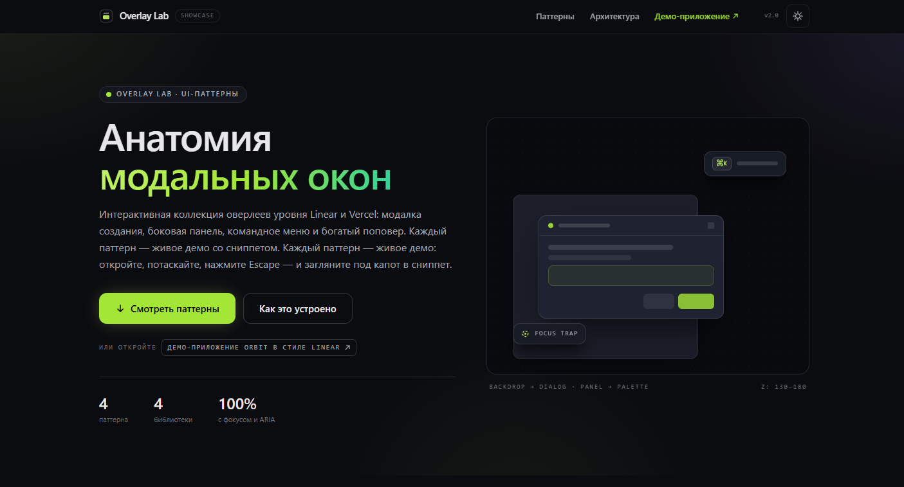

# Overlay Lab — витрина паттернов модальных окон

[](https://nodejs.org/)
[](https://www.typescript.org/)
[](LICENSE)

> **Status**: ACTIVE
> **Last Updated**: 2026-11-09

Интерактивная коллекция оверлеев уровня Linear и Vercel. Каждый паттерн — живое демо
со сниппетом исходника: откройте, потаскайте, нажмите Escape и загляните под капот.
Проект построен на тулчейне [stsgs1980/webstorm-config](https://github.com/stsgs1980/webstorm-config)
(ESLint, Prettier, Stylelint, Vitest, Husky) и рассчитан на разработку в WebStorm.

## Скриншот



## Features

- Standard Modal — классический диалог на Base UI: focus-trap, inert-фон,
  scroll-lock, создание задачи с ⌘/Ctrl+Enter.
- Side Panel — Linear-паттерн: детали задачи и комментарии справа,
  OverlayContainer + FocusScope, без backdrop.
- Command Menu — палитра уровня Raycast: фильтрация, группы с разделителями,
  ⌘/Ctrl+K, навигация со стрелок, запуск по Enter.
- Rich Popover — немодальный поповер выбора приоритета (usePopover): flip-позиционирование,
  aria-стек, listbox с aria-labelledby/describedby.
- Макет SaaS-приложения «Orbit» (`/app`): сайдбар, очередь задач, Base UI Tabs —
  вкладки открывают демонстрационные оверлеи поверх живого интерфейса.
- Реестр модальных слоёв (ModalStackContext) и живой «монитор стека» — видно,
  что открыто и в каком порядке.
- Доступность: у всех оверлеев aria-labelledby и aria-describedby,
  prefers-reduced-motion учитывается.

## Tech Stack

- **Language**: TypeScript (strict), React 19
- **Framework**: Next.js 16 (App Router), Tailwind CSS 4
- **Overlays**: `@base-ui/react` (Dialog, Tabs), `react-aria` / `react-stately`
  (панель, палитра, поповер)
- **Icons**: lucide-react
- **Linting**: ESLint 9, Stylelint, markdownlint, Prettier (из webstorm-config)
- **Testing**: Vitest
- **Hooks**: Husky, lint-staged, Commitlint

## Getting Started

### Prerequisites

- Node.js >= 22.22.2 (основные джобы CI и локально — 24.15.0 из `.nvmrc`;
  floor-джоба — ровно 22.22.2)
- npm проверяет `engines` (`engine-strict=true` в `.npmrc`): неподходящая версия
  Node/npm останавливает `npm ci`.

### Installation

```bash
git clone <repository-url>
cd overlay-patterns-showcase
npm ci
npm run dev
```

Приложение поднимается на <http://localhost:3000> (витрина) и
<http://localhost:3000/app> (макет «Orbit»).

### Сборка и запуск в production

```bash
npm run build
npm start
```

## Scripts

|     | Команда                           | Описание                                      |     |
| --- | --------------------------------- | --------------------------------------------- | --- |
|     | `npm run dev`                     | Dev-сервер на порту 3000                      |     |
|     | `npm run build`                   | Production-сборка                             |     |
|     | `npm start`                       | Production-сервер на порту 3000               |     |
|     | `npm run lint`                    | ESLint (`--max-warnings=0`)                   |     |
|     | `npm run lint:prettier-conflicts` | Конфликты правил ESLint с Prettier            |     |
|     | `npm run lint:metrics`            | Метрики (advisory, не блокирует)              |     |
|     | `npm run lint:css`                | Stylelint                                     |     |
|     | `npm run lint:md`                 | markdownlint                                  |     |
|     | `npm run typecheck`               | `tsc --noEmit`                                |     |
|     | `npm run format`                  | Prettier (запись)                             |     |
|     | `npm run format:check`            | Prettier (проверка, как в CI)                 |     |
|     | `npm test`                        | Vitest (пустой набор — ошибка)                |     |
|     | `npm run test:watch`              | Vitest (watch)                                |     |
|     | `npm run test:coverage`           | Vitest + coverage                             |     |
|     | `npm run check:file-length`       | Лимит 250 строк на файл                       |     |
|     | `npm run check:docs`              | Сверка доков с конфигами                      |     |
|     | `npm run check:templates`         | Live-шаблоны: рендер, ESLint, tsc             |     |
|     | `npm run check:style-consistency` | Согласованность .editorconfig/.prettierrc/IDE |     |
|     | `npm run changelog`               | Пересборка `CHANGELOG.md`                     |     |

## Docs

|     | Документ                                          | О чём                            |     |
| --- | ------------------------------------------------- | -------------------------------- | --- |
|     | [getting-started.md](docs/getting-started.md)     | Шаги после клона, миграция       |     |
|     | [webstorm.md](docs/webstorm.md)                   | Настройка WebStorm               |     |
|     | [webstorm-settings.md](docs/webstorm-settings.md) | Перенос настроек на новую машину |     |
|     | [testing.md](docs/testing.md)                     | Vitest, jsdom, Testing Library   |     |
|     | [markdown.md](docs/markdown.md)                   | Правила оформления `.md`         |     |
|     | [architecture.md](docs/architecture.md)           | Границы модулей и зависимости    |     |
|     | [security.md](docs/security.md)                   | Секреты, вход, авторизация       |     |
|     | [api.md](docs/api.md)                             | Контракты HTTP API               |     |

## Architecture

Витрина построена по слоям с зависимостями внутрь:

- `src/app/` — маршруты (`/` — витрина, `/app` — макет Orbit), layout, globals.css;
- `src/components/patterns/` — паттерны (StandardModal, SidePanel, CommandMenu, RichPopover);
- `src/components/mock-app/` — макет «Orbit» (Sidebar, AppHeader, IssueList, MockApp);
- `src/components/layout/` — секции витрины (hero, сетка паттернов, архитектура);
- `src/components/ui/` — базовые примитивы (Button, Badge, Tabs, Toast, CodeBlock);
- `src/hooks/`, `src/lib/`, `src/types/`, `src/context/` — логика, данные и типы;
- `scripts/` — тулинг шаблона (`check:file-length`, `check:docs` и остальные ворота).

Детали — в [architecture.md](docs/architecture.md). Z-index оверлеев: единая
лестница в `src/lib/utils.ts` (`Z`): popover 130 < panel 140 < dialog 150 < palette 170 < toast 180.

## Conventions

Стиль кода: 2 пробела, двойные кавычки, точка с запятой, trailing commas, 120 символов
в строке, JSDoc для публичного API. Канонические правила — `AGENTS.md` (указатель для
AI Assistant — `.aiassistant/rules/AI Rules.md`). Коммиты — Conventional Commits
(`feat:`, `fix:`, `chore:`…), ветка `main` — solo-maintainer, каждый коммит проходит
pre-commit (lint-staged + лимит файлов) и CI.

## Contributing

1. `git checkout -b feat/your-feature`
2. `git commit -m "feat: add your feature"`
3. `git push origin feat/your-feature`

## License

MIT — см. [LICENSE](LICENSE).
